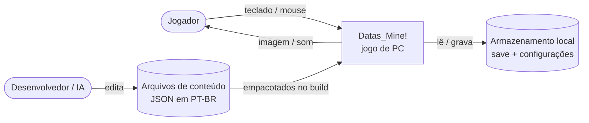
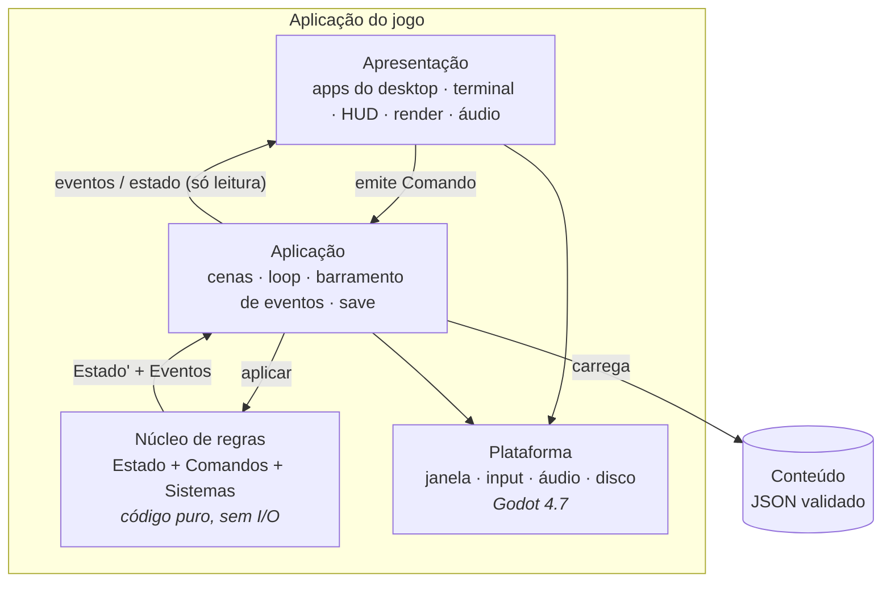
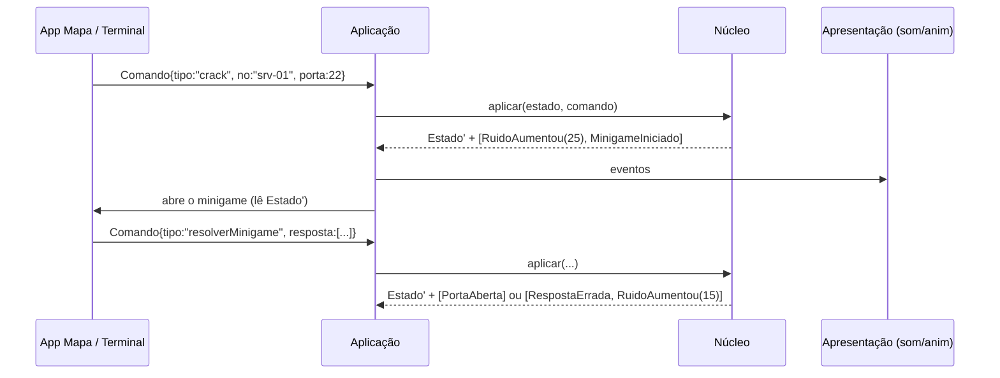
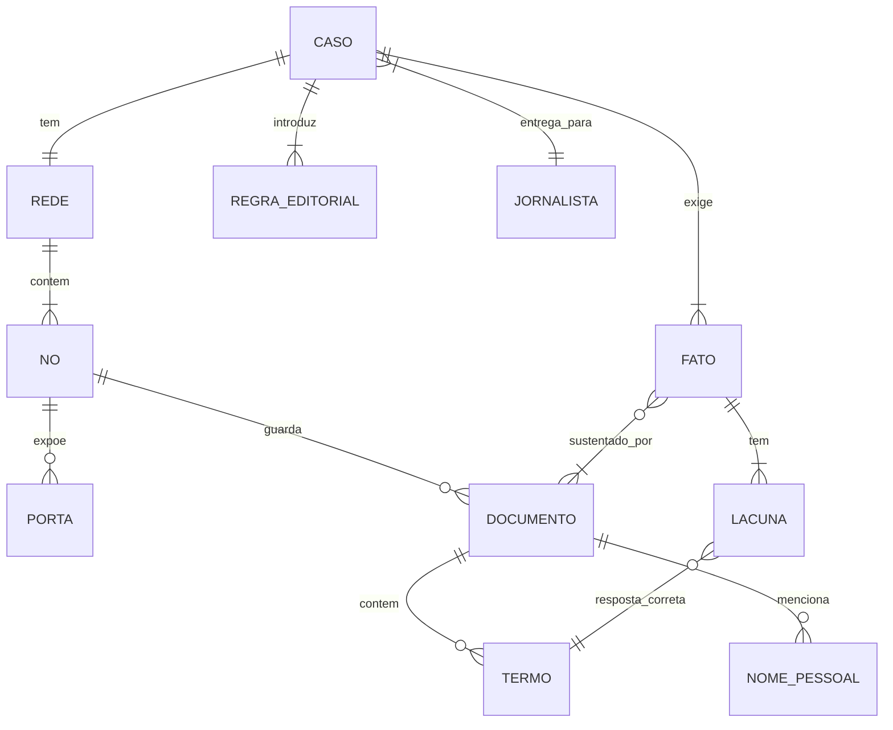

# Arquitetura — Datas_Mine!

> **Como este documento é organizado.** Segue o modelo **arc42** (12 seções, adaptado ao tamanho do projeto), com diagramas no estilo **C4** (contexto → contêineres → componentes). As decisões ficam em **ADRs** separados, na pasta `Decisões/`. Os requisitos de qualidade seguem as categorias da **ISO/IEC 25010**. Fontes no fim.
>
> **Regra de manutenção:** este documento descreve **o que é** a arquitetura. O **porquê** de cada escolha mora nos ADRs. Ao mudar algo estrutural, registre primeiro um `/decisao` e depois atualize as seções afetadas aqui.

Relacionados: [[GDD]] · [[0001 - Conceito central - campanha de casos para a imprensa]] · [[0002 - Interação híbrida com progressão]] · [[0003 - Idioma do jogo - PT-BR]] · [[0004 - Engine e linguagem - Godot 4.7 com GDScript]]

> **Tecnologia:** Godot 4.7 + GDScript, com o renderizador **Compatibility** (ADR 0004). As seções 1 a 6 continuam independentes da tecnologia. A seção **5.4** mostra como cada camada vira coisas do Godot.

---

## 1. Introdução e objetivos

### 1.1 O que o sistema faz
Um jogo de PC, de 1 a 2 horas, em PT-BR. O jogador atravessa **5 casos** e cada caso tem três fases:
1. **Invadir:** grafo de rede, ferramentas, orçamento de ruído.
2. **Montar o dossiê:** coletar termos, preencher fatos com lacunas, ocultar nomes de inocentes.
3. **Entregar:** o checklist editorial da jornalista.

A **Exposição** acumula ao longo da campanha, e o jogo tem 4 finais. Detalhes no [[GDD]].

### 1.2 Objetivos de qualidade (top 3)
| Prioridade | Objetivo | Por quê |
|---|---|---|
| 1 | **Testabilidade das regras** | O jogo *é* um conjunto de regras (ruído, lacunas, checklist, finais). Um bug de regra quebra o quebra-cabeça. Cada regra precisa de teste automatizado |
| 2 | **Conteúdo editável sem código** | Casos, documentos, termos, fatos e textos vão mudar a cada playtest. Editar conteúdo não pode exigir mexer em lógica |
| 3 | **Simplicidade / aprendizado** | O projeto é solo, feito com IA e serve para aprender. A arquitetura precisa ser pequena, legível e explicável |

### 1.3 Partes interessadas
| Quem | Interesse |
|---|---|
| Desenvolvedor (Vini) | Entender e manter o código, aprender com ele |
| Subagents do harness (`game-programmer`, `qa-reviewer`) | Fronteiras claras para implementar e revisar sem ambiguidade |
| Playtesters | Um build jogável e estável a cada iteração |
| Jogadores (itch.io) | Um jogo fluido, sem perder o save |

---

## 2. Restrições
| Restrição | Origem |
|---|---|
| **Godot 4.7 + GDScript**, renderizador **Compatibility** (OpenGL 3.3) | [[0004 - Engine e linguagem - Godot 4.7 com GDScript]] |
| Hardware de desenvolvimento modesto: 8 GB de RAM, GPU sem Vulkan (GT 630) | `Conhecimento/Setup do PC.md` (cérebro) |
| PT-BR, com **todos os textos em arquivos de dados** | [[0003 - Idioma do jogo - PT-BR]] |
| **Uma única camada de comandos** para a GUI e o terminal | [[0002 - Interação híbrida com progressão]] |
| PC, de 1 a 2 h, de 60 FPS a 1080p em hardware modesto | [[GDD]] |
| Git, Conventional Commits, testes passando antes do commit | `CLAUDE.md` do cérebro |
| Nenhuma pessoa ou instituição real no conteúdo | [[0001 - Conceito central - campanha de casos para a imprensa]] |

---

## 3. Contexto e escopo (C4, nível 1)



- **Dentro do escopo:** tudo o que roda no computador do jogador.
- **Fora do escopo:** rede/servidor, contas, telemetria, multiplayer, conquistas de loja (talvez no futuro).

---

## 4. Estratégia de solução
| Problema | Estratégia | Referência |
|---|---|---|
| Regras testáveis | **Núcleo funcional, casca imperativa** (*functional core, imperative shell*): a lógica de jogo é feita de funções puras sobre um `Estado`. Input, render, áudio e disco ficam na casca | Gary Bernhardt, "Boundaries" |
| GUI e terminal com as mesmas regras | **Padrão Command**: toda ação do jogador vira um `Comando` (dado). Um único executor aplica comandos ao estado | *Game Programming Patterns*, cap. Command |
| Sistemas desacoplados | Cada comando aplicado devolve **eventos** (`RuidoAumentou`, `FatoComprovado`...). A UI e o áudio reagem aos eventos (Observer) e não mexem no estado | *Game Programming Patterns*, cap. Observer / Event Queue |
| Fluxo entre telas | **Máquina de estados** de cenas (pilha: desktop → invasão / dossiê / entrega → resultado) | *Game Programming Patterns*, cap. State |
| Conteúdo mutável | **Orientação a dados**: casos, redes, documentos, termos, fatos, regras e textos em JSON, com validação por esquema | [[Boas práticas]] |
| Lógica independente do FPS | **Loop com passo fixo** para a lógica e render interpolado. A lógica atual é quase toda por turno, então o passo fixo serve para animações e feedback | Glenn Fiedler, *Fix Your Timestep!* |

**Ideia central em uma linha:**

```
(Estado, Comando) ──aplicar──▶ (Estado', Evento[])
```

Esse é o coração do jogo: é determinístico, testável e não sabe nada de tela.

---

## 5. Visão de blocos

### 5.1 Contêineres (C4, nível 2)


**Regra de dependência (obrigatória):** as setas de código apontam **para dentro**. O `Núcleo` não importa nada de `Aplicação`, `Apresentação` ou `Plataforma`. Ele só conhece os tipos de conteúdo. Isso se verifica em revisão (`/revisar`) e, se a linguagem permitir, com uma regra de lint.

### 5.2 Componentes do núcleo (C4, nível 3)
| Componente | Responsabilidade | Principais comandos / funções |
|---|---|---|
| `estado` | Tipos do `Estado` do jogo (campanha, caso atual, rede, ruído, caderno, dossiê, exposição) | criação do estado inicial a partir do conteúdo |
| `comandos` | Definição de todos os `Comando` e o **executor** `aplicar(estado, comando)` | despacha para os sistemas, valida pré-condições, devolve eventos |
| `invasao` | Grafo da rede, visibilidade dos nós, portas, acesso | `scan`, `probe`, `crack`, `entrarComPista`, `read`, `download`, `limparRastros`, `desconectar` |
| `ruido` | Custo de cada ação, orçamento do caso, lockdown | `custo(acao, melhorias)`, `verificarLockdown` |
| `exposicao` | Medidor da campanha: aumentos e reduções | `aplicarExposicao(evento)` |
| `caderno` | Termos coletados dos documentos | `coletarTermo` |
| `dossie` | Fatos com lacunas, preenchimento, ocultação de nomes | `preencherLacuna`, `limparLacuna`, `ocultarNome`, `fatoEstaCompleto` |
| `editorial` | Checklist da jornalista por caso: regras acumuladas, feedback (parcial a partir do caso 2) | `avaliarDossie(dossie, regras) → Parecer` |
| `campanha` | Ordem dos casos, desbloqueios (ferramentas, terminal), métricas finais, escolha do final | `concluirCaso`, `calcularFinal` |

Cada sistema é um **módulo de funções puras**. Nenhum guarda estado escondido. Tudo entra e sai pelo `Estado`.

### 5.3 Componentes da aplicação e da apresentação
| Componente | Responsabilidade |
|---|---|
| `cenas` | Pilha de cenas: `Boot`, `Desktop`, `Resultado`, `Final`. As fases do caso são **apps dentro do Desktop**, não cenas separadas |
| `loop` | Passo fixo, distribuição de input, chamada do render |
| `eventos` | Barramento: a apresentação assina os eventos (som, animação, notificações) |
| `save` | Serializa o `Estado` com `versaoSave`. Migrações entre versões. Salva automaticamente ao concluir uma fase |
| `conteudo` | Carrega e **valida** o JSON na inicialização. Falha com uma mensagem clara se o conteúdo estiver quebrado |
| `apps/*` | Mapa da rede, leitor de arquivos, caderno, quadro de evidências, chat/memorando, painel de regras. Cada app **lê** o estado e **emite comandos** |
| `terminal` | Parser de texto → o **mesmo** `Comando` que os apps emitem. Histórico e autocompletar |
| `render` / `audio` | Desenho e som. Reagem a eventos, sem regra de jogo |

### 5.4 Mapeamento para o Godot
| Camada | No Godot | Regra |
|---|---|---|
| Núcleo | `res://nucleo/*.gd`: classes `RefCounted` (sistemas com funções `static`) e `Resource`/Dictionary para o `Estado` | **Proibido** usar `Node`, `get_tree()`, `Input`, `FileAccess` ou autoloads |
| Comandos | `res://nucleo/comandos.gd`: `Comando` como Dictionary tipado ou classe. `aplicar(estado, comando) -> Resultado{estado, eventos}` | O único jeito de mudar o estado |
| Aplicação | Autoload `Jogo` (`res://app/jogo.gd`): guarda o estado atual, executa comandos, emite `signal evento(e)`, salva e carrega | O único dono do `Estado` em runtime |
| Conteúdo | `res://conteudo/**/*.json` + `res://app/conteudo.gd` (carregar e validar) | Falha alto se o conteúdo estiver inválido |
| Apresentação | `res://ui/` (cenas `Control`: `Desktop.tscn`, `apps/*.tscn`, `Terminal.tscn`), `Theme` em `res://ui/tema.tres`, áudio em `res://audio/` | Lê o estado só para ler e emite comandos via `Jogo.executar(cmd)` |
| Save | `user://save.json`, `{versaoSave, estado}` | Migrações testadas |
| Testes | `res://testes/` com GUT ou gdUnit4. Execução por linha de comando (`godot --headless ...`) | Núcleo e conteúdo testados sem abrir janela |

```
res://
├── nucleo/        ← regras puras (testáveis sem cena)
├── app/           ← autoload Jogo, carregamento de conteúdo, save
├── ui/            ← cenas e temas (apresentação)
├── conteudo/      ← JSON dos casos e textos PT-BR
├── audio/ · arte/
└── testes/
```

---

## 6. Visão de execução (cenários-chave)

### 6.1 `crack` pelo app (vale igual para o terminal)


### 6.2 Lockdown
Um comando faz `ruido ≥ orcamento` → o núcleo emite `[Lockdown, ExposicaoAumentou(n), Desconectado]` e reinicia o estado da rede do caso (o que você coletou continua no caderno). A apresentação toca o efeito e volta ao desktop.

### 6.3 Preencher uma lacuna e entregar
`preencherLacuna(fato, lacuna, termoId)` → `FatoAtualizado`. Na entrega: `entregarDossie` → `editorial.avaliarDossie` → `Parecer{aprovado, falhas[], camposErrados?}` → o chat mostra a resposta da jornalista. Se aprovado: `CasoConcluido` → `campanha` desbloqueia o próximo caso e o save é gravado.

---

## 7. Visão de implantação
| Item | Decisão atual |
|---|---|
| Plataforma alvo | PC (Windows primeiro) |
| Forma do build | Exportação do Godot para **Windows Desktop** (`.exe` + `.pck`), com o renderizador Compatibility. Linux e Web ficam possíveis no futuro |
| Distribuição | itch.io (zip). Steam fica para depois |
| Dados do jogador | Save + configurações em armazenamento local do usuário (o caminho depende da plataforma) |

---

## 8. Conceitos transversais

### 8.1 Modelo de conteúdo (entidades)

- **Ids estáveis** (`"caso1.doc.contrato_merenda"`) separados do **texto exibido**. A lógica só compara ids (veja a ADR 0003).
- O formato exato (JSON Schema) será a **ADR 0005**, derivada do caso 1 escrito no papel.

### 8.2 Textos (PT-BR)
- Nenhuma string visível ao jogador fica no código: tudo vem de `conteudo/textos/*.json` ou do próprio conteúdo dos casos.
- UTF-8 em tudo. A fonte precisa ter todos os acentos do português.

### 8.3 Validação de conteúdo
- Esquema para cada tipo, validado ao carregar **e** num teste automatizado.
- **Testes de conteúdo:** todo fato do caso tem solução com termos que existem; todo termo de resposta aparece em algum documento coletável; o caminho ideal de cada rede cabe no orçamento de ruído. Isso evita quebra-cabeças impossíveis.

### 8.4 Save e versões
- `{ versaoSave, estado }`. Cada mudança no formato do estado incrementa `versaoSave` e ganha uma função de migração com teste.

### 8.5 Testes (pirâmide)
| Nível | O quê | Quantidade |
|---|---|---|
| Unidade | Cada sistema do núcleo (ruído, lacunas, checklist, finais) | Muitos |
| Conteúdo | Validade e solucionabilidade dos casos | Um por caso |
| Cenário | Sequências de comandos que jogam um caso inteiro (vitória, lockdown, dossiê recusado) | Poucos, mas importantes |
| Manual | Playtest silencioso (de 5 a 7 por marco) | Por marco |

Como o núcleo é determinístico, um **cenário é só uma lista de comandos**. Isso serve também para reproduzir bugs ("comandos até o bug").

### 8.6 Depuração
- Overlay de debug (FPS, estado atual, últimos eventos), ativado por uma tecla.
- Log de comandos aplicados na sessão, que pode ser exportado como cenário de teste.

### 8.7 Acessibilidade
- Tamanho de fonte ajustável. O medidor de ruído não depende só de cor (tem número e forma). Opção para reduzir os efeitos de tela (interferência e tremida).

### 8.8 Aleatoriedade
- O conteúdo é roteirizado, sem aleatoriedade na lógica. Se ela for necessária, use um RNG com **semente** guardada no estado, para manter o determinismo.

---

## 9. Decisões de arquitetura
| ADR | Título | Status |
|---|---|---|
| [[0001 - Conceito central - campanha de casos para a imprensa\|0001]] | Conceito central | aceita |
| [[0002 - Interação híbrida com progressão\|0002]] | Interação híbrida e camada única de comandos | aceita |
| [[0003 - Idioma do jogo - PT-BR\|0003]] | Idioma PT-BR, textos em dados | aceita |
| [[0004 - Engine e linguagem - Godot 4.7 com GDScript\|0004]] | Godot 4.7 + GDScript, renderizador Compatibility | aceita |
| 0005 | Formato do conteúdo (JSON) | **pendente**, depois do caso 1 no papel |
| 0006 | Núcleo funcional + Command + eventos (seção 4) e framework de testes | **a registrar** no setup do projeto Godot |

---

## 10. Requisitos de qualidade (cenários, ISO/IEC 25010)
| Categoria | Cenário mensurável |
|---|---|
| Testabilidade | Cada regra do núcleo tem teste de unidade. A suíte do núcleo roda em menos de 5 s |
| Modificabilidade | Adicionar um documento ou fato ao caso 1 exige mexer **só** em JSON, e os testes de conteúdo pegam o erro |
| Corretude funcional | Todo caso tem pelo menos um caminho de solução, verificado por um teste de cenário |
| Eficiência | 60 FPS estáveis em 1080p. Carregamento inicial abaixo de 3 s |
| Confiabilidade | Fechar o jogo a qualquer momento perde no máximo a fase atual. Um save antigo abre em versões novas (migração testada) |
| Usabilidade | O caso 1 é concluído por um jogador novo sem ajuda externa (playtest) |
| Portabilidade | O núcleo compila e testa sem a camada de plataforma |

---

## 11. Riscos e dívida técnica
| Risco | Impacto | Mitigação |
|---|---|---|
| A lógica vai parar em nós do Godot (tentação da engine) | Regras espalhadas e sem teste | Regra 5.4 (núcleo sem `Node`) + checagem no `/revisar` |
| GPU sem Vulkan | Efeitos limitados | Compatibility desde o início. Efeitos CRT com shaders simples de `CanvasItem` |
| Formato de conteúdo instável | Retrabalho em tudo | Derivar o formato do caso 1 real (ADR 0005), com testes de conteúdo desde o começo |
| Três fases = escopo grande | O protótipo não fecha | O protótipo é só o caso 1 e só o desktop. O terminal fica para o vertical slice |
| Volume de texto | Gargalo de produção | Textos em dados, edição direta no Obsidian/VS Code, poucos documentos por caso |
| Quebra-cabeça impossível ou chutável | Mata a diversão | Testes de solucionabilidade + playtests silenciosos + feedback parcial controlado |
| Lógica vazando para a UI | Bugs e regras duplicadas | Regra de dependência (5.1) checada no `/revisar` |

---

## 12. Glossário
| Termo | Significado |
|---|---|
| **Caso** | Uma unidade da campanha: alvo + rede + fatos + regra editorial + jornalista |
| **Nó** | Um computador ou serviço na rede do caso (não confundir com "nó" de engine) |
| **Ruído** | O orçamento de ações dentro de uma invasão. Se estourar → lockdown |
| **Exposição** | O risco acumulado na campanha inteira. Define o final "preso" |
| **Termo** | Um dado coletável de um documento (nome, valor, data, empresa, código) |
| **Fato** | Uma frase com lacunas que, preenchida corretamente e com documentos que a sustentam, vira uma prova |
| **Parecer** | A resposta da jornalista ao dossiê: aprovado ou falhas (+ campos errados) |
| **Comando** | Uma ação do jogador representada como dado. É a única forma de mudar o estado |
| **Evento** | Algo que aconteceu ao aplicar um comando. A apresentação reage a eventos |
| **Núcleo** | O código puro de regras: sem tela, som, input ou disco |

---

## Fontes (boas práticas de documentação)
- **arc42**, modelo de documentação de arquitetura: https://arc42.org/overview · documentação: https://docs.arc42.org/home/
- **C4 model** (Simon Brown), diagramas em níveis: https://c4model.com/
- **Architecture Decision Records** (Michael Nygard, 2011): https://www.cognitect.com/blog/2011/11/15/documenting-architecture-decisions
- **ISO/IEC 25010**, modelo de qualidade de software: https://iso25000.com/index.php/en/iso-25000-standards/iso-25010
- **Functional core, imperative shell** (Gary Bernhardt, "Boundaries"): https://www.destroyallsoftware.com/talks/boundaries
- **Game Programming Patterns** (Robert Nystrom): https://gameprogrammingpatterns.com/
- **Fix Your Timestep!** (Glenn Fiedler): https://gafferongames.com/post/fix_your_timestep/

## Histórico
- 2026-11-18: v0.2. Tecnologia definida (ADR 0004: Godot 4.7 + GDScript + Compatibility). Seção 5.4 de mapeamento, implantação e riscos atualizados.
- 2026-11-18: v0.1. Primeira versão independente da tecnologia (arc42 + C4), escrita antes da ADR 0004 (linguagem).
